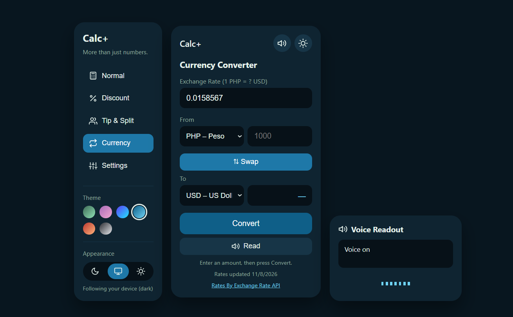
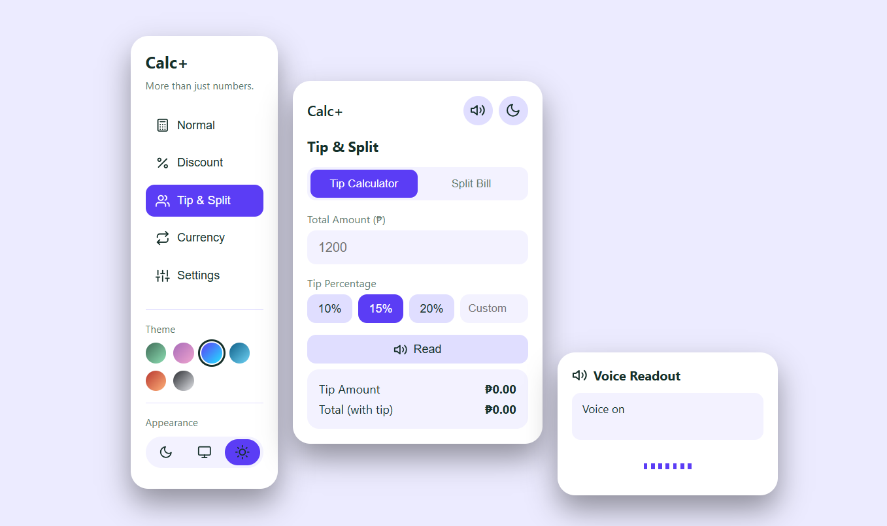

# Calc+

More than just numbers. A multi-mode calculator built with plain HTML, CSS, and JavaScript, with no frameworks or libraries.

**[Live demo](https://jyagou.github.io/Calc-plus/)**

## Screenshots

## Features

- **Calculator** with correct order of operations (`7 + 3 × 4 = 19`), keyboard support, and a saved history you can click to reuse
- **Discount calculator** that shows the sale price and how much you save
- **Tip and Split Bill** modes, with an optional tip when splitting
- **Currency converter** with 10 currencies, live rates, and an offline fallback
- **Voice readout** that says your answer in words ("one hundred and one"), with an animated sound wave
- **6 color palettes** and **Dark / Auto / Light** appearance that remembers your choice
- Settings to turn voice on and off, clear history, or reset everything

## Built with

HTML, CSS (custom properties, grid, flexbox), and vanilla JavaScript (DOM events, `localStorage`, `fetch`, Web Speech API).

## What I learned

- **Debugging with the Console:** one leftover line from old code crashed my script and stopped
  everything below it, including the theme picker. The browser Console showed the exact error,
  so now I check it first.
- **Data structures matter:** my calculator only remembered one operator, so it couldn't do
  order of operations. Storing the expression as a list fixed it.
- **Working with APIs:** I used `fetch` and `async/await` to load live exchange rates, and added
  a saved copy and a fallback so the app still works offline.
- **CSS variables:** I built 6 palettes and dark/light/auto modes by changing variables
  instead of rewriting styles.
- Double check block of codes, if a code appear twice, as experienced in the updateCurrency function... it can result to a crash.
- When a script crashes, everything below the block of code which crashed won't run.

## Known limitations

- Exchange rates update about once a day. If you're offline, Calc+ uses rough sample rates, and you can type your own rate in the box.
- Splitting a bill that doesn't divide evenly rounds each share to the nearest centavo.
- There are no parentheses buttons yet.

## Credits

- Exchange rates by [Exchange Rate API](https://www.exchangerate-api.com)
- Icons based on [Feather Icons](https://feathericons.com) (MIT license)

## Run it yourself

Download or clone the repository and open `index.html` in your browser. No installation is needed.
